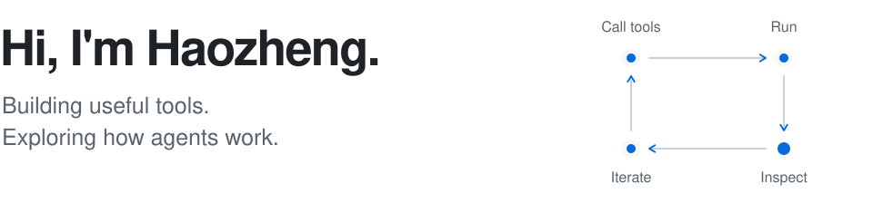
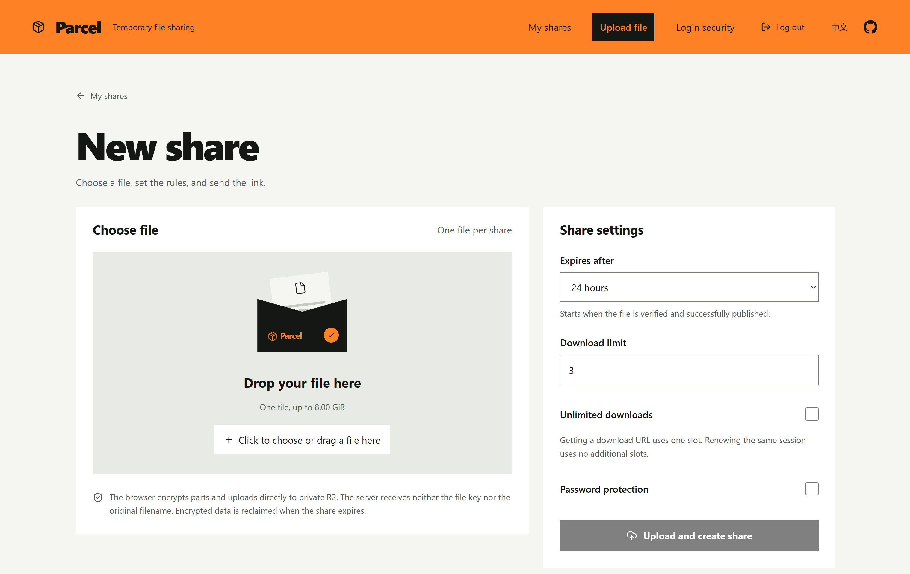

<picture>
  <source media="(max-width: 600px) and (prefers-color-scheme: dark)" srcset="assets/header-mobile-dark.svg">
  <source media="(max-width: 600px)" srcset="assets/header-mobile-light.svg">
  <source media="(prefers-color-scheme: dark)" srcset="assets/header-dark.svg">
  
</picture>

Computer Science undergraduate at **Minzu University of China**, interested in
**open source, AI, Web3, and infrastructure**. Linux enthusiast with a soft spot
for developer tools.

Currently exploring **agent loops, tool calling, and harness design**, while
contributing to open source. I enjoy building things, breaking things, and
figuring out how they work.

[Personal website](https://lihaozheng.dev) · [GitHub](https://github.com/hyphy-void)

## [Parcel](https://github.com/hyphy-void/Parcel)

**End-to-end encrypted file sharing, on your own Cloudflare account.**

Encrypt files in the browser, share a link, and let them expire automatically.
Resumable transfers, optional passwords, and download limits keep sharing
practical. Built with React, TypeScript, Cloudflare Workers, D1, and R2.

<!-- Original screenshot: https://github.com/hyphy-void/Parcel/blob/main/docs/images/new-share-en.png -->

[Repository](https://github.com/hyphy-void/Parcel) ·
[Deployment guide](https://parcelwiki.pages.dev/) ·
[Encryption design](https://github.com/hyphy-void/Parcel/blob/main/docs/e2ee-protocol.md)
